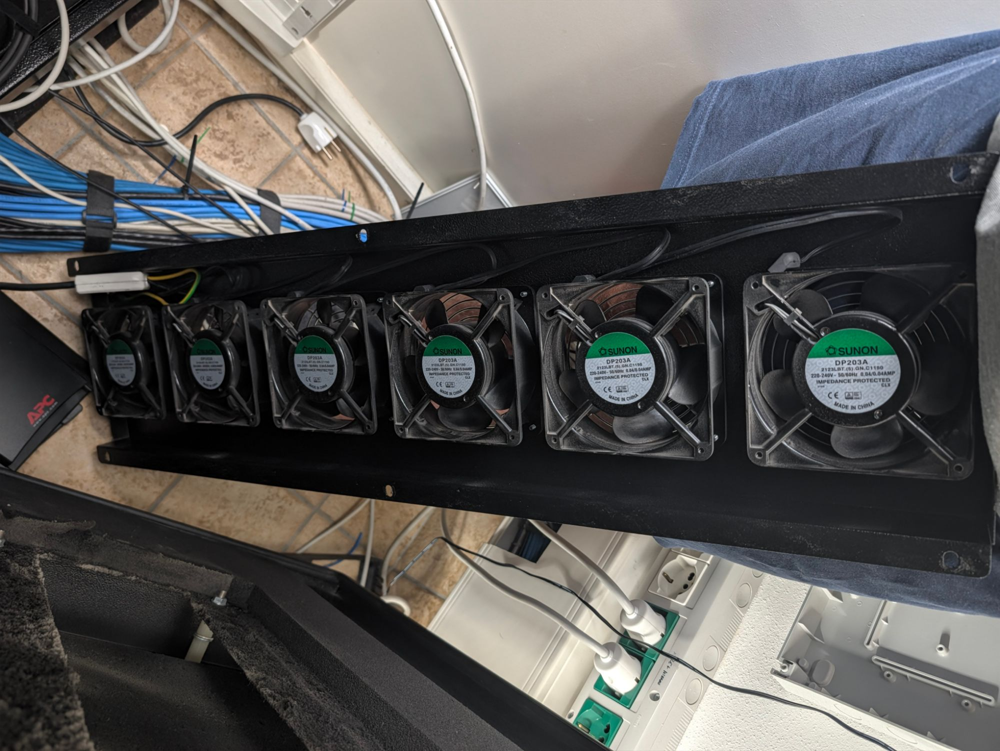
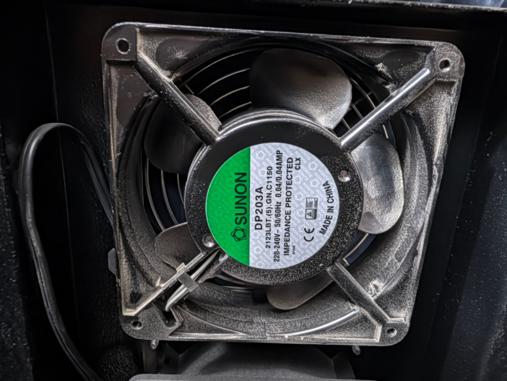

# Rack Fan

ESPHome controller for the rack's 19" fan tray:
- **Fans:** six 120 mm PWM fans, each with its own PWM output and tachometer. FAN1 is the **LOW** zone and FAN6 the **HIGH** zone; the board's silkscreen marks them, and the tray should be mounted so that FAN1 ends up at the bottom. The fans are attached from the outside, so their depth (25 or 38 mm) is free.
- **Probes:** eight DS18B20 temperature probes on two 1-Wire buses: five inside the rack, inlet, outlet, and one in the other room. The hot zone has probes on both buses.
- **Control:** one PID loop on the hot zone. The lower fans run slower than the upper ones while the bottom of the rack is cool enough, and speed is only raised when the in/out temperature difference says it helps.

Files and hardware:
- Firmware: [`rack-fan.yaml`](rack-fan.yaml), with one [`rack-fan-channel.yaml`](rack-fan-channel.yaml) included per fan
- Controller: WT32-ETH01 (ESP32 + LAN8720 Ethernet)
- Board: [`rack-fan-pcb/`](rack-fan-pcb/), a KiCad 10 project (manufactured PCB, through-hole parts only); every board decision, with pin-by-pin reasons and alternatives, is in [`rack-fan-pcb/README.md`](rack-fan-pcb/README.md)
- Datasheets and photos: [`rack-fan-data/`](rack-fan-data/)

## Current fans: SUNON DP203A 2123LBT

Today the tray holds **6 × SUNON DP203A 2123LBT.(5).GN.C1150**, plugged straight into mains, with no control.





The DP203A is a **230 V AC** fan (shaded-pole motor, aluminium frame, 2 wires).
It has **no PWM input and no tach output**, so it cannot be speed-controlled.
From the [datasheet](rack-fan-data/sunon-dp200a-series-120x120x38-ac.pdf) (row `2123LBT.GN`, ball bearing):

| | 50 Hz | 60 Hz |
|---|---|---|
| Voltage | 220–240 VAC | 220–240 VAC |
| Current | 0.05 A | 0.06 A |
| Power | 10 W | 10 W |
| Speed | 2300 RPM | 2150 RPM |
| Airflow | 78 CFM | 72 CFM |
| Static pressure | 0.13 inH₂O | 0.09 inH₂O |
| Noise | 39 dB(A) | 37 dB(A) |

- **Size:** 119 × 119 × 38.5 mm, 104.8 mm hole spacing, Ø4.3 mm holes.
- **Label vs. datasheet:** the label reads 0.04/0.04 A, lower than the datasheet's 0.05/0.06 A.
- **Six fans on mains (50 Hz):** about 468 CFM and 60 W in total, always at full speed.

## Replacement fans

### Targets

- 120 mm, 25 or 38 mm deep, 12 V or 24 V DC, 4 wires (PWM in, tach out).
- **Normal operation at or below 39 dB(A)** per fan, the DP203A's level.
- **At least 78 CFM** per fan, the DP203A's airflow, which the tray vendor sized the tray for. More is welcome.
- **Emergency:** a bit more noise is acceptable, but nowhere near double (+10 dB(A) sounds twice as loud).

### Does a bigger fan capped by firmware buy anything?

**At the same noise, no.** The "airflow at 39 dB(A)" column below estimates each fan's airflow when slowed to 39 dB(A), using the fan laws:
- airflow ∝ speed
- noise changes by about 50·log₁₀(speed ratio)

Almost every candidate lands at **85–98 CFM at 39 dB(A)**. A 54 dB(A) fan capped to 39 dB(A) moves about the same air as a 39 dB(A) fan at full speed.

What the extra size does buy:
1. **Emergency headroom:** when the AC fails, the firmware lifts the noise cap. That is only worth paying for up to the noise you would actually tolerate in an emergency. A fan topping out at 54–62 dB(A) is headroom you will never use.
2. **Life:** industrial fans are rated for longer, and running slower extends bearing life further.

**So the right fan is one whose 100% sits at your acceptable emergency noise (about 40–44 dB(A)) and whose 39 dB(A) point is above 78 CFM.**

### Recommendation

**Noctua NF-F12 industrialPPC-24V-3000 PWM:**
- **Normal:** capped at about 80% speed for 39 dB(A), it moves about 89 CFM, 14% more than the DP203A.
- **Emergency:** 100% gives 110 CFM (+41%) at 43.5 dB(A), only 4.5 dB(A) more.
- **Low end:** 750 RPM at 20% duty, so it is very quiet when there is nothing to do.
- **Build:** 24 V, IP67, high static pressure (7.63 mmH₂O, which matters with the tray's grilles), MTTF over 150 000 h.
- **Power:** about 4.3 W max per fan, so all six draw about 26 W.
- **Vibration:** the frame has integrated extra-soft silicone anti-vibration pads (per Noctua). They reduce the vibration passed into the tray and rack, which would otherwise act as a sounding board. The DP203A is metal bolted to metal.
  - The benefit is real but not captured by the dB(A) figures, which measure airborne noise only.
  - Any other fan can get the same with silicone mounting pins or gaskets.

**Alternative (12 V): Phanteks T30-120.** About 101 CFM at 39.7 dB(A) at full speed, so it needs no cap. But it has no emergency headroom, and it is a consumer fan with no published life rating.

### All options

**"Airflow at 39 dB(A)" is an estimate** from the fan laws: free-air airflow at the speed where the fan reaches 39 dB(A), with the percentage of max speed needed. Speed is not the same as PWM duty; set the actual cap with the tach readings.

Checks of the estimate against datasheet points:
- **9LG at 20%:** the datasheet gives 36 dB(A); the law predicts 35.4.
- **9RA at 25%:** the datasheet gives 25 dB(A); the law predicts 29. So for the 9RA the estimate is conservative.

| Fan | Description | Depth | Noise (max) | Airflow (max) | Airflow at 39 dB(A) (est.) | Consumption (max) | Voltage |
|---|---|---|---|---|---|---|---|
| SUNON DP203A 2123LBT *(installed)* | Installed today. AC shaded-pole fan, no PWM, no tach, always full speed | 38.5 mm | 39 dB(A) | 78 CFM | 78 CFM @ 100% | 10 W (0.05 A) | 230 VAC 50 Hz |
| **Noctua NF-F12 industrialPPC-24V-3000** ★ | **Noctua industrial, fast grade.** IP67, MTTF > 150 000 h. 750 RPM at 20% | 25 mm | 43.5 dB(A) | 109.9 CFM | ≈ 89 CFM @ 81% | 4.32 W (0.18 A) ⁵ | 24 VDC |
| Phanteks T30-120 ⁶ | Consumer high-end, 30 mm deep. Full speed is already at 39.7 dB(A) | 30 mm | 39.7 dB(A) | 101 CFM | ≈ 98 CFM @ 97% | — | 12 VDC |
| be quiet! Silent Wings Pro 4 120 ⁶ | Consumer high-end. Never exceeds 39 dB(A), little headroom | 25 mm | 36.9 dB(A) | 83.9 CFM | 83.9 CFM @ 100% | 3.6 W | 12 VDC |
| San Ace 9RA1224P1K001 | **Low-noise series**, the quietest at low duty. 30 000 h life | 38 mm | 50 dB(A) | 158 CFM | ≈ 95 CFM @ 60% | 11.5 W (0.48 A) | 24 VDC |
| San Ace 9RA1212P1K001 | Low-noise series, 12 V version. 30 000 h life | 38 mm | 50 dB(A) | 158 CFM | ≈ 95 CFM @ 60% | 11.5 W (0.96 A) | 12 VDC |
| San Ace 9LG1224P1H001 | Long-life series (120L), slowest grade. 180 000 h life. **Cannot go below 36 dB(A)** (2000 RPM at 20%) except by stopping | 38 mm | 54 dB(A) | 176.5 CFM | ≈ 88 CFM @ 50% | 16.8 W (0.7 A) | 24 VDC |
| San Ace 9LG1212P1H001 | Long-life, slowest grade, 12 V version. 180 000 h life | 38 mm | 54 dB(A) | 176.5 CFM | ≈ 88 CFM @ 50% | 16.8 W (1.4 A) | 12 VDC |
| San Ace 9LG1224P1S001 | Long-life, middle speed grade. 180 000 h life | 38 mm | 58 dB(A) | 211.8 CFM | ≈ 88 CFM @ 42% | 26.4 W (1.1 A) | 24 VDC |
| San Ace 9LG1212P1S001 | Long-life, middle speed grade, 12 V version. 180 000 h life | 38 mm | 58 dB(A) | 211.8 CFM | ≈ 88 CFM @ 42% | 26.4 W (2.2 A) | 12 VDC |
| San Ace 9LG1224P1G001 | Long-life, fastest/loudest grade. 180 000 h life | 38 mm | 62 dB(A) | 247.1 CFM | ≈ 86 CFM @ 35% | 38.4 W (1.6 A) | 24 VDC |
| San Ace 9LG1212P1G001 | Long-life, fastest/loudest grade, 12 V version. 180 000 h life | 38 mm | 62 dB(A) | 247.1 CFM | ≈ 86 CFM @ 35% | 38.4 W (3.2 A) | 12 VDC |
| San Ace 9GV1212P1G01 ¹ | High-performance series, 12 V. Never stops (1500 RPM at 0%). 40 000 h life | 38 mm | 60 dB(A) | 192.6 CFM | ≈ 73 CFM @ 38% | 25.2 W (2.1 A) | 12 VDC |
| San Ace 9GV1224P1H01 | High-performance series, slower 24 V grade. 40 000 h life | 38 mm | 58 dB(A) | 182.3 CFM | ≈ 76 CFM @ 42% | 19.2 W (0.8 A) | 24 VDC |
| San Ace 9GV1224P1J01 | High-performance series, fastest 24 V grade. 40 000 h life | 38 mm | 64 dB(A) | 224 CFM | ≈ 71 CFM @ 32% | 36 W (1.5 A) | 24 VDC |
| Sunon PMD2412PMB2-A ² | Sunon high-speed PMD series, slower grade (PMB2) | 38 mm | 51 dB(A) | 170 CFM | ≈ 98 CFM @ 58% | 13.7 W (0.57 A) | 24 VDC |
| Sunon PMD1212PMB2-A ² | Sunon high-speed PMD series, slower grade (PMB2), 12 V | 38 mm | 51 dB(A) | 170 CFM | ≈ 98 CFM @ 58% | 14.4 W (1.2 A) | 12 VDC |
| Sunon PMD2412PMB1-A ² | Sunon high-speed PMD series, faster grade (PMB1) | 38 mm | 54 dB(A) | 190 CFM | ≈ 95 CFM @ 50% | 18.2 W (0.76 A) | 24 VDC |
| Sunon PMD1212PMB1-A ² | Sunon high-speed PMD series, faster grade (PMB1), 12 V | 38 mm | 54 dB(A) | 190 CFM | ≈ 95 CFM @ 50% | 19.2 W (1.6 A) | 12 VDC |
| Delta AFC1212DE ³ | Delta high-speed PWM fan | 38 mm | 45.4 dB(A) | 154.5 CFM | ≈ 115 CFM @ 74% | 19.2 W (1.6 A) | 12 VDC |
| ebm-papst 4114 N/2H4P ³ | ebm-papst industrial, mildest of the three | 38 mm | 66 dB(A) | 207 CFM | ≈ 60 CFM @ 29% | 26 W | 24 VDC |
| ebm-papst 4114 N/2H7P ³ | ebm-papst industrial, very high speed | 38 mm | 76 dB(A) | 294.2 CFM | ≈ 54 CFM @ 18% | 90 W | 24 VDC |
| ebm-papst 4114 N/2H8P ³ | ebm-papst industrial, maximum speed (11 000 RPM) | 38 mm | 78 dB(A) | 336 CFM | ≈ 56 CFM @ 17% | 120 W | 24 VDC |
| Noctua NF-F12 industrialPPC-24V-2000 ⁴ | Noctua industrial, quiet grade. Stops at 0%. Below the 78 CFM target | 25 mm | 29.7 dB(A) | 71.7 CFM | 71.7 CFM @ 100% | 1.6 W (0.07 A) | 24 VDC |
| Noctua NF-F12 industrialPPC-2000 ⁴ | Same fan, 12 V version | 25 mm | 29.7 dB(A) | 71.7 CFM | 71.7 CFM @ 100% | 1.2 W | 12 VDC |

Decoding San Ace model numbers, e.g. `9LG1224P1H001`:
- **`9LG`:** the series. 9LG = long life, 9RA = low noise, 9GV = high performance.
- **`12`:** frame size, 120 mm.
- **`24`:** rated voltage, 12 or 24 V.
- **`P`:** PWM control.
- **`H` / `S` / `G` / `J` / `K`:** speed grade. Only compare grades within one series: in 9LG, H < S < G; in 9GV, H < G < J.
- **`001` / `01`:** variant suffix. An extra trailing `1` means the version without ribs.

Life figures are L10 at 60 °C, from the San Ace catalogs.

Footnotes:
1. Does not stop at 0% duty: it keeps running at 1500 RPM.
2. The datasheet ([`sunon-pmd-120x120x38.pdf`](rack-fan-data/sunon-pmd-120x120x38.pdf)) lists the 2-wire parts. **A PWM + tach variant is not verified.**
3. Figures from distributor or reseller listings, not manufacturer datasheets. The Delta listings disagree with each other across variants.
4. Figures from Noctua datasheets as quoted by search results; Noctua's site blocked direct fetches.
5. Noctua gives 4.32 W max (3.6 W typical). A reseller's 0.3 A figure contradicts that; 4.32 W at 24 V is 0.18 A.
6. Figures from reseller and review listings, not a manufacturer datasheet.

Notes on the figures:
- **Sources:** the San Ace and SUNON figures come from the manufacturer datasheets in [`rack-fan-data/`](rack-fan-data/).
- **Noise across vendors:** each vendor measures noise its own way. San Ace uses 1 m from the inlet; SUNON and the consumer brands don't state their method. Treat a 2–3 dB(A) difference between vendors as noise.
- **Free-air figures:** all airflows are free-air. Behind the tray's grilles, fans with higher static pressure lose less.
- **Six fans:** six identical fans are about +7.8 dB(A) over one, for the DP203A and any replacement alike.
- **Excluded San Ace fans:** the 9RA and 9G catalogs also list fans without PWM (voltage-controlled only), e.g. 9RA1224H1001 (99 CFM, 37 dB(A), 3.1 W).

## Temperature probes

On hand: 5 × DS18B20 and 5 × NTC 10k 1% B3950.

**The DS18B20s are used; the NTCs are not.**
- The DS18B20 needs only one GPIO for all probes, and the bus has room for more.
- An NTC needs an analog input. All the ESP32's ADC1 pins are taken (32/33 for PWM, 35/36/39 for tach), so NTCs would need an I2C ADC (ADS1115) and two pins, and no pins are free.

Each probe is named after the board connector it plugs into, and ESPHome shows it under that name:

| Name (connector) | Bus | Where | Used for | ESPHome entity |
|---|---|---|---|---|
| TEMP1 (J21) | A | inside, rear, top | hot zone (PID input) | `Rack Fan TEMP1 Rear High` |
| TEMP2 (J25) | B | inside, rear, middle | hot zone (PID input) | `Rack Fan TEMP2 Rear Mid` |
| TEMP3 (J22) | A | inside, rear, bottom | bottom zone (gradient) | `Rack Fan TEMP3 Rear Low` |
| TEMP4 (J26) | B | inside, front, top | hot zone (PID input) | `Rack Fan TEMP4 Front High` |
| TEMP5 (J23) | A | inside, front, bottom | bottom zone (gradient) | `Rack Fan TEMP5 Front Low` |
| TEMP6 (J27) | B | outside, in the fans' exhaust | usefulness cap (outlet − inlet), hot zone − outlet | `Rack Fan TEMP6 Outlet` |
| TEMP7 (J24) | A | outside, where air enters the rack | usefulness cap (outlet − inlet) | `Rack Fan TEMP7 Inlet` |
| TEMP8 (J28) | B | in the other room | monitoring only | `Rack Fan TEMP8 Other Room` |

**Buses:** odd connectors (TEMP1, 3, 5, 7) are bus A, even ones (TEMP2, 4, 6, 8) bus B. The hot zone has probes on both buses (Rear High on A, Rear Mid and Front High on B), so a whole bus failing (a cable crushed in the rack, one shorted probe pulls the whole bus down) still leaves a hot-zone reading and control carries on instead of going to the 100% emergency. Both bottom probes are on bus A. Cables: TEMP1–5 are 2 m (inside the rack), TEMP6–8 are 5 m.

A DS18B20 is identified by its 64-bit **address**, not by the connector. The name only holds if each probe goes into the connector its address is assigned to (see setup below).

Zones:
- **Hot zone** = the hottest of Rear High (TEMP1), Rear Mid (TEMP2) and Front High (TEMP4).
- **Bottom zone** = the hotter of Rear Low (TEMP3) and Front Low (TEMP5).
- **Other Room** (TEMP8) only feeds `Delta Inlet-Other Room`: positive means the other room is colder than the air entering the rack, so bringing its air in (external fans) would help. It does not change the rack fans.

### What happens when a probe fails

Every failure falls back to more cooling, never less:

| Failure | Effect |
|---|---|
| one or two hot-zone probes | the hot zone uses the ones left |
| all three hot-zone probes | **emergency: all fans 100%** |
| both bottom probes (TEMP3 and TEMP5) | no gradient: lower fans run like the top one |
| inlet or outlet | usefulness cap off |
| bus A | Rear Mid and Front High keep control; no gradient, usefulness cap off |
| bus B | Rear High keeps control; usefulness cap off, no Other Room |
| other room | `Delta Inlet-Other Room` unavailable, nothing else |

A probe that drops out reads as unavailable in Home Assistant, and the binary sensor **`Rack Fan Probe Missing`** (problem) turns on once any probe with an address set has read nothing for 30 s. Use it for an alert: a lost bus no longer shows up as fans at 100%.

### Wiring and setup

- **Buses:** bus A on **GPIO5** (WT32 pin 7, connectors TEMP1/3/5/7 = J21–J24) and bus B on **GPIO17** (WT32 pin 8, TEMP2/4/6/8 = J25–J28), each with a **4.7 kΩ pull-up to 3.3 V**. Power the probes with 3 wires, not parasitic.
- **Connectors:** JST XH 3-pin vertical (B3B-XH-A): 1 GND, 2 DQ, 3 VDD. Screw terminals did not fit on the grid.
- **Module LEDs:** the WT32-ETH01 has LED3 on GPIO5 and LED4 on GPIO17 (each 3V3 → LED → 1 kΩ → pin). They blink with bus traffic and add about 1.3 mA of pull-up, well within the DS18B20's 4 mA sink.
- **Why two buses:** a fault on one bus leaves half the probes (one of each pair) working, and each bus's star of cables from the board stays short.
- **Topology:** run the cable as a line from probe to probe, not a star. For long runs, lower the pull-up (e.g. 2.2 kΩ).
- **Addresses:** each probe is identified by its 64-bit address.
  1. Flash once and press **`Scan 1-Wire probes`** (Home Assistant or http://172.16.80.71/; a scan also runs 10 s after every boot).
     - The diagnostic text sensors **`1-Wire bus A scan`** and **`1-Wire bus B scan`** list every probe found, e.g. `0x28ff641e0f3c1a2b=UNASSIGNED; 0x28ff6a1e0f2e4f11=TEMP1; MISSING: TEMP3; not set: TEMP2`.
     - The log has one line per probe, with the full TEMP name.
     - Every probe shows up as **TEMPn** (assigned), **UNASSIGNED** (new: copy its address), or **wrong bus** (assigned to a TEMP of the other bus: move it).
     - Every TEMP of that bus that is **not set**, or set but **MISSING** (not found), is also listed.
  2. Fill in `addr_temp1_rear_high` … `addr_temp8_other_room`.
  3. Plug each probe into the connector of its name.

  To tell probes apart, plug them in one at a time, or warm one in your hand and watch which reading moves. **Until its address is set, a TEMP reads nothing.** Without readings for the hot zone, the fans run at 100%.

  This is enforced in the firmware: on its own, an address of `0` makes ESPHome auto-select the only probe on the bus. With one probe connected, every unassigned TEMP would then show that probe's value, and the emergency would never trigger.
- **Calibration:** the DS18B20 is ±0.5 °C, so two probes can disagree by up to 1 °C. That is significant against the 1.5 / 4 °C outlet − inlet thresholds.
  - Bundle all probes together for an hour.
  - Note how far each one is from the average.
  - Set the matching `offset_tempN_…` substitutions so they agree.

## Control logic

One PID climate (`Rack Fan Thermostat`) regulates the **hot zone** and produces one demand. The `update_fans` script turns it into six duties, re-evaluated every 5 s and on every PID update:

1. **Emergency.** If the hot zone is at or above *Emergency Temperature* (default 40 °C), or no hot-zone probe is readable, all fans go to 100% and every cap below is ignored.
2. **Usefulness cap.** If outlet − inlet is small, the air is already exchanged faster than the rack heats it, so the inside is about as cool as the inlet air allows. More speed then mostly adds noise.
   - *Useful dT Low* (1.5 °C) or less caps the demand at *Not Useful Cap* (40%).
   - *Useful dT High* (4 °C) or more removes the cap.
   - In between, the cap rises linearly.
   - If the inlet or outlet probe is unreadable, the cap is off.
3. **Noise cap.** *Max Duty* (default 100%). Set it to the duty that gives your noise limit, e.g. about 80% speed for the NF-F12 24V-3000. Read the RPM off the tach to set it.
4. **Gradient.** While the bottom zone is below the setpoint, the lower fans run slower than the top one:
   - fan 1 runs up to *Gradient* % (default 30%) slower than fan 6, and the reduction shrinks linearly to 0 at fan 6
   - the full gradient applies once the bottom zone is *Gradient Band* (2 °C) below setpoint, and it fades to none as the bottom zone reaches the setpoint
5. **Minimum duty.** A fan that is not stopped runs at least 20% (`fan_min_duty`).

The **manual override** (`Manual Fan Speed`) sets all six fans to the same level and bypasses the PID, the caps and the gradient.

Diagnostics published to Home Assistant:

| Entity | Meaning |
|---|---|
| `Temperature Hot Zone` | PID input |
| `Delta Outlet-Inlet` | heat picked up by the air crossing the rack, which drives the usefulness cap |
| `Delta Hot Zone-Outlet` | large means heat is pocketed inside and not reaching the fans (recirculation, blocked path). More airflow is not the fix for that |
| `Delta High-Low` | vertical stratification inside the rack |
| `Usefulness Cap`, `Gradient Applied` | what the logic is doing right now |
| `Emergency` | emergency override active |
| `Fan n Speed`, `Fan n Duty`, `Fan n Stalled` | per fan. Stalled = duty > 20% but < 200 RPM for 30 s |

## Wiring

### Fan signals

All candidates use the standard 4-wire interface:
- the PWM input is pulled up inside the fan
- the tach is an open collector with 2 pulses per revolution

| | San Ace 9RA ([catalog](rack-fan-data/sanyo-denki-san-ace-120-9ra-120x120x38.pdf)) | Noctua industrialPPC 24 V (Noctua PWM white paper) |
|---|---|---|
| PWM frequency | 25 kHz | 25 kHz (21–28 kHz) |
| PWM input | pulled up to 5 V inside; VIH 4.75–5.25 V, VIL 0–0.4 V; 1 mA | pulled up to 3.3/5 V inside; VIL ≤ 0.8 V; 5.25 V abs. max; 5 mA |
| Open control wire | 100% | — |
| Tach | open collector, VCE 30 V max | open collector, 2 mA max |
| Wires | + red, − black, tach yellow, PWM brown | see fan label |

The [9LG catalog](rack-fan-data/sanyo-denki-san-ace-120l-9lg-120x120x38.pdf) doesn't repeat the PWM input thresholds; they are assumed identical to the 9RA.

### Driving the PWM wire

The ESP32 can't drive the control wire directly:
- The fan pulls the wire up to as much as 5 V, above the 3.3 V I/O rating.
- 3.3 V does not reach the San Ace's VIH of 4.75 V.

**Use one 2N3904 NPN per fan as an open-collector, inverting stage:**

```
                                            fan's internal pull-up
                                                     │
GPIO ──┬──[4.7 kΩ]── 2N3904 base                     │
       │             collector ──────────────────────┴── fan PWM wire (pin 4)
   [100 kΩ]          emitter ── GND
       │
      GND
```

How it behaves:
- **Drive:** 3.3 V through 4.7 kΩ gives about 0.55 mA of base current. That saturates the transistor well below 0.4 V for the few mA a fan input sinks, so it is guaranteed at 3.3 V.
- **Firmware:** the stage inverts, so the firmware sets `inverted: true` and the output level equals the fan's duty cycle.
- **Fail-safe:** GPIO low, floating or unpowered turns the transistor off, so the wire floats high and **the fan runs at 100%**. That is the right failure for a rack.
  - **Exception: FAN1 (GPIO1).** GPIO1 has an internal pull-up during reset, then carries the ROM boot message and idles high. FAN1 therefore stops for about a second at each boot or OTA reboot, and stays stopped if the ESP32 is stuck rebooting or held in reset. Accepted: GPIO1 is the pin closest to FAN1, and every other usable pin had the same or a worse problem.
- **Boot:** the 100 kΩ pull-downs keep the strapping pins GPIO2 and GPIO12 low at boot (GPIO12 high would mean no boot).
- **Firmware start:** ESPHome creates the LEDC outputs at level 0, which with `inverted: true` switches the transistors on. `on_boot` sets all six fans to 100% immediately after, so the fans don't sit stopped until the first control update.

Why not the alternatives:
- **2N7000:** its worst-case gate threshold is 3 V, too close to the 3.3 V drive.
- **74LVC06A:** surface-mount only.
- **BSS138 level-shifter modules:** their 3.3 V-side pull-up holds GPIO2/GPIO12 high at boot. GPIO12 high means **no boot**.
- **74AHCT125 buffers:** non-inverting, so a dead GPIO stops the fan.
- **TXB0108/TXS0108 auto-direction shifters:** misbehave with the fans' pull-ups.
- **ULN2003/2803 Darlington arrays:** saturate at about 0.9 V, above the San Ace's VIL of 0.4 V.
- **PCA9685 (I2C PWM chip):** at most 1526 Hz (about 3 kHz with an external clock), and the fans need 21–28 kHz. Its I2C bus also costs 2 pins, so it frees nothing.

### Tach inputs

Each fan's tach goes **straight to its own GPIO** (3, 39, 36, 15, 14, 35 for FAN1–FAN6). Each is counted continuously by one of the ESP32's hardware pulse counters, so the RPM is live (averaged over the 10 s update interval, which can be shortened).

- Open collector, pulled up to **3.3 V** (never 5 V): one 10 kΩ per fan on the board.
- The pull-ups are required on GPIO35/36/39, which are input-only with no internal pull-up.
- **Glitch filter:** `internal_filter: 13us` (the hardware maximum, 12.8 µs). It also removes the ~80 ns low glitches that ESP32 erratum GPIO-3.11 puts on GPIO36/39 when the ADC powers on. The firmware doesn't use the ADC; the filter is a safeguard.
- **No tach on the module's LED pins:** GPIO5/17 would add up to ~1.5 mA through the module's LED, against the Noctua's 2 mA tach rating. They carry the 1-Wire buses instead.

**Why only 6 fans:** the WT32-ETH01 has 14 usable pins. 6 PWM + 6 tach + 2 probe buses uses all 14.
- **8 fans** would need a tach multiplexer (74HC4052), which only reads one fan at a time, so RPM would update every ~10 s.
- **Alternatives** are a second microcontroller that counts the tachs and reports over I2C, or an I2C fan-controller chip (MAX31790, EMC2305). Both are surface-mount, and ESPHome has no support for either.

### Grounds

Connect the fan supply ground and the controller ground at one point.

## Board (`rack-fan-pcb/`)

A KiCad 10 project for a **manufactured PCB** (≈ 66.5 × 87 mm, through-hole parts). It started as a perfboard design.

- WT32-ETH01 mounted face down in two 1 × 12 female sockets (pins 13 and 14, at the RJ45 end, hang past the board edge).
- Six fan channels in one column, FAN1 (LOW) at the top.
- TEMP1–TEMP8 (JST XH), power top-left, 4 × M3 holes not connected to GND.
- Star ground: logic ground enters the WT32 through one GND pin; the module's GND, 3V3 and EN pins are declared as jumper groups.

Every decision, the pin-by-pin reasons and alternatives, the layout rules and the open items are in [`rack-fan-pcb/README.md`](rack-fan-pcb/README.md).

## WT32-ETH01 pinout

**Taken by Ethernet:**
- 0 (50 MHz clock in), 16 (oscillator enable / PHY power), 18 (MDIO), 23 (MDC)
- RMII data lines: 19, 21, 22, 25, 26, 27

**Exposed on the header:** 1, 2, 3, 4, 5, 12, 14, 15, 17, 32, 33, 35, 36, 39. The board uses all 14.

The "Pin" column is the WT32 header pin number (footprint pad). Pins 14–26 are one row, 1–13 the other. The caveats assume the firmware workarounds are in place (`on_boot` 100%, ESP-IDF console off, 13 µs tach filter).

| Pin | GPIO | Function | Caveat |
|---|---|---|---|
| 26 | IO1 | PWM1 | FAN1 stops for about a second at each boot and during OTA reboots: the ROM boot message, then the pin idles high until `on_boot` sets 100%. It stays stopped if the ESP32 is stuck rebooting or held in reset |
| 25 | IO3 | TACH1 | None |
| 24 | IO0 | BOOT header (J4) | Ethernet clock input: only the short trace to J4. Never leave the jumper on 1-2 in normal use |
| 23 | — | GND | None |
| 22 | IO39 | TACH2 | None (errata 80 ns glitch filtered) |
| 21 | IO36 | TACH3 | None (errata 80 ns glitch filtered) |
| 20 | IO15 | TACH4 | Holds the strapping pin high, so the ROM boot message stays on (that's what causes FAN1's stutter). Undocumented hobby claim of a short pulse burst at boot; Espressif documents output disabled |
| 19 | IO14 | TACH5 | Same undocumented boot-burst claim; Espressif documents output disabled |
| 18 | IO12 | PWM2 | Must never be pulled high (no boot). The 100k pull-down guarantees that |
| 17 | IO35 | TACH6 | None |
| 16 | IO4 | PWM3 | None |
| 15 | IO2 | PWM4 | None |
| 14 | — | GND | No socket: past the board edge |
| 1 | EN | X | Unconnected (pin 4 carries EN) |
| 2 | — | GND | None |
| 3 | 3V3 | X | Same rail as pin 10; unconnected |
| 4 | EN | EN | C3 (470 µF) to GND: delays the ESP32's start by about 1.5–2 s so the supply settles first. Fixes the known WT32 boot hang on slow-ramping supplies |
| 5 | IO32 | PWM5 | None |
| 6 | IO33 | PWM6 | None |
| 7 | IO5 | ONEWIRE_A | The module's LED3 blinks with bus traffic and adds about 1.3 mA to the 1-Wire pull-up (fine for the DS18B20) |
| 8 | IO17 | ONEWIRE_B | The module's LED4 blinks with bus traffic and adds about 1.3 mA to the 1-Wire pull-up (fine for the DS18B20) |
| 9 | — | GND | None |
| 10 | 3V3 | 3.3V | Supply for the pull-ups and probes, well under 50 mA |
| 11 | — | GND | None |
| 12 | 5V | +5V | Fed from the TSR 1-2450 |
| 13 | LINK | X | No socket: past the board edge |

Apart from FAN1, every fan sits at 100% from power-on until the firmware takes over.

**Rules, if a pin ever has to move:**
- PWM must use 15 (IO2) and 18 (IO12); the other PWMs are best on 16 (IO4), 5 (IO32), 6 (IO33). Pins with a pull-up at reset (IO3, IO5, IO14, IO15), the module LED pins (IO5, IO17) and IO1 make that fan stop during reset/boot.
- TACH must use 17, 21, 22 (input-only). Never put a tach on 26 (IO1, driven at boot), and avoid the LED pins 7 and 8.
- 1-Wire works on any output-capable pin except 15 (IO2) and 18 (IO12).

**Serial:** UART0 (GPIO1/3) carries FAN1, so there is no serial console at runtime; logs come over the API and the web server. To flash over serial, use the UART header J2 with the BOOT jumper J4 (see the PCB README), or take the module out of its sockets. After the first flash, update over the network.

**Sources:**
- [ESP32 datasheet v5.3](https://www.espressif.com/sites/default/files/documentation/esp32_datasheet_en.pdf): strapping pins, IO_MUX reset states
- [ESP32 errata GPIO-3.11](https://docs.espressif.com/projects/esp-chip-errata/en/latest/esp32/03-errata-description/index.html)
- [WT32-ETH01 V1.4 schematic (egnor/wt32-eth01)](https://github.com/egnor/wt32-eth01)
- [WT32-ETH01 boot hang after power-up (WLED forum)](https://wled.discourse.group/t/wt32-eth01-hangs-on-boot-after-psu-power-up/2937)

## Firmware

Built for the **latest ESPHome (2026.10.1) on the ESP-IDF framework**.

[`rack-fan.yaml`](rack-fan.yaml) holds:
- Ethernet (current `clk:` syntax), API, OTA, web server
- `on_boot`: all fans to 100% as soon as the outputs exist
- `sdkconfig_options`: `CONFIG_ESP_CONSOLE_NONE` and `CONFIG_BOOTLOADER_LOG_LEVEL_NONE`, so ESP-IDF's own messages don't toggle FAN1's PWM on GPIO1
- the two 1-Wire buses and the probes (addresses and calibration offsets as substitutions)
- the PID and the `update_fans` script
- the tuning numbers
- the manual override and the daily restart

[`rack-fan-channel.yaml`](rack-fan-channel.yaml) is included once per fan for the PWM output, tach, duty readback and stall detection.

Tuning numbers exposed in Home Assistant:
- **PID:** kp, ki, kd, deadband thresholds, deadband ki multiplier.
- **Fan logic:** Max Duty, Emergency Temperature, Useful dT Low / High, Not Useful Cap, Gradient, Gradient Band.

Defaults are starting points to tune on the real rack.

The pin map matches `rack-fan-pcb/` exactly. Odd TEMP connectors are bus A, even ones bus B (see Temperature probes); any probe can move to the other bus by changing its `one_wire_id` and plugging it into a connector of that bus.

Validated and compiled (`esphome compile`) on ESPHome 2026.10.1 with ESP-IDF; not yet run on hardware.

## Power

Load: six NF-F12 24V-3000 at about 4.32 W each, about 26 W (1.1 A), plus about 1.5 W for the controller.

| Supply | Type | Rating | Fits |
|---|---|---|---|
| **Mean Well GST90A24-P1M** | desktop adapter, constant-voltage | 24 V, 3.75 A, 90 W | **J5** barrel jack (5.5/2.5) |
| Mean Well XLG-100-24-A | LED driver, constant-current / constant-voltage, IP67 | 24 V, 4 A, 100 W | **J1** screw terminal |
| Mean Well XLG-75-24-A | LED driver, constant-current / constant-voltage, IP67 | 24 V, 3.1 A, 75 W | **J1** screw terminal |

**Chosen: GST90A24-P1M.**
- It is a true constant-voltage supply.
- It plugs into a wall socket, so there is **no mains wiring at all**.
- The P1M plug is **5.5/2.5 mm**, centre positive, so J5 must be a 2.5 mm-pin jack. The common DC-005 jack comes in both pin sizes with the same body, so the footprint fits either.
- No jack takes both 2.1 and 2.5 reliably: a 2.1 pin accepts a 2.5 plug but with loose contact, and a 2.5 pin doesn't accept a 2.1 plug. If you'd rather use the more common 5.5/2.1 (generic 12 V adapters in Italy are mostly 2.1), order the GST90A24-P1J and a 2.1 jack.

The XLG drivers also work:
- Below their current setting they behave as a plain 24 V supply. Leave the potentiometer at maximum.
- They have flying mains leads that must be terminated in an enclosure or junction box with earth, wired by someone qualified.
- Check in the datasheet that the constant-voltage level is 24 V.

On the board:
- **F1:** 5×20 mm fuse, **T2A** (slow-blow), in a Stelvio-Kontek PTF78 holder (same footprint as espfreezanz).
- **D1:** 1N5822 Schottky for reverse polarity. It drops about 0.5 V, so the fans see about 23.5 V.
- **C1:** 470 µF bulk.
- **U2:** Traco TSR 1-2450 (6.5–36 V in, 5 V 1 A) feeds the WT32-ETH01's 5V pin.
- **3.3 V:** pull-ups and DS18B20s take it from the WT32-ETH01's own regulator, well under 50 mA in total.

## Bill of materials

Status: **have** = on hand, **buy** = to order, **check** = verify whether you already have it. 

### Fans and power

| Qty | Ref | Item | Why | Status |
|---|---|---|---|---|
| 6 | — | Noctua NF-F12 industrialPPC-24V-3000 PWM | Replaces the 6 × DP203A: about 89 CFM at 39 dB(A) when capped, 110 CFM at 43.5 dB(A) in emergency, silicone pads. Several variants exist (IP67, SP IP67, Q100); confirm the specs of the exact one you order | buy |
| 1 | — | Mean Well GST90A24-P1M (or XLG-100-24-A / XLG-75-24-A, see Power) | 24 V supply | buy |
| 1 | U2 | Traco TSR 1-2450 | 24 V → 5 V, 1 A, for the WT32-ETH01 | buy |
| 1 | F1 | Fuse holder 5×20 mm, Stelvio-Kontek PTF78 + fuse T2A 5×20 | Protects the wiring on a short | buy |
| 1 | D1 | 1N5822 | Reverse polarity protection | buy |
| 1 | C1 | 470 µF 35 V electrolytic, radial 10 mm | Bulk capacitance on the fan rail | buy |
| 1 | C2 | 47 µF 10 V electrolytic | Regulator output | buy |
| 1 | C3 | 470 µF 10 V electrolytic, radial 6.3 mm, 2.5 mm pitch | EN delay: avoids the WT32 boot hang when the supply ramps slowly | buy |

### Controller and logic

| Qty | Ref | Item | Why | Status |
|---|---|---|---|---|
| 1 | U1 | WT32-ETH01 | ESP32 with wired Ethernet | check |
| 2 | U1 | 1 × 12 female header socket, 2.54 mm (or a 1 × 13 cut down) | The WT32-ETH01 plugs in and can be removed | buy |
| 1 | — | USB-serial adapter, **3.3 V** logic | The WT32-ETH01 has no USB; first flash only | check |
| 6 | Q1–Q6 | 2N3904 (TO-92) | Open-collector PWM stage per fan | buy |
| 6 | R1–R6 | 4.7 kΩ, ¼ W axial (7.62 mm pitch, lying) | Base resistors | buy |
| 6 | R11–R16 | 100 kΩ | Pull-downs: strapping pins low at boot, floating GPIO = fan 100% | buy |
| 6 | R21–R26 | 10 kΩ | Tach pull-ups to 3.3 V | buy |
| 2 | R31, R32 | 4.7 kΩ | 1-Wire pull-ups, one per bus (2.2 kΩ for long cables) | buy |
| 1 | — | PCB from `rack-fan-pcb/` (≈ 66.5 × 87 mm) + enclosure | The board | buy |
| 4 | H1–H4 | M3 screws + standoffs (holes not connected to GND) | Mounting | buy |
| 3 | J2–J4 | 1 × 3 male pin header, 2.54 mm | UART (GND/RX/TX), RESET (EN), BOOT (IO0) | buy |
| 2 | — | 2.54 mm jumper | RESET and BOOT, parked on pins 2-3 | buy |

### Connectors and cabling

| Qty | Ref | Item | Why | Status |
|---|---|---|---|---|
| 6 | J11–J16 | 4-pin PC fan header (2.54 mm, Molex KK 47053 style) | The Noctuas plug straight in | buy |
| 0–6 | — | 4-pin fan extension cable, e.g. Noctua NA-EC1 | Only if the fan leads don't reach the board | check |
| 1 | J5 | DC barrel jack **5.5/2.5 mm**, PCB mount, ≥ 2.5 A (DC-005 style) | 24 V in from the GST90A24-P1M | buy |
| (1) | J1 | 2-pin screw terminal, 5.08 mm | 24 V in from an XLG instead of J5 | if XLG |
| 8 | J21–J28 | JST XH 3-pin vertical header (B3B-XH-A) | TEMP1–TEMP8: DS18B20 probes (GND, DQ, 3V3); odd on bus A, even on bus B | buy |
| 8 | — | JST XHP-3 housing + 24 SXH crimp contacts | Plugs on the probe cables | buy |
| — | — | 3-core cable | 1-Wire bus, as a line, not a star | check |

### Temperature probes

| Qty | Item | Why | Status |
|---|---|---|---|
| 5 | DS18B20 (waterproof probe), 2 m | TEMP1–TEMP5, inside the rack | have |
| 3 | DS18B20 (waterproof probe), 5 m | TEMP6 Outlet, TEMP7 Inlet, TEMP8 Other Room | have |

### Mechanical

| Qty | Item | Why | Status |
|---|---|---|---|
| 24 | Fan screws | Included with the Noctuas (4 per fan). **Check** that the tray's holes and sheet thickness suit them. The DP203A frame is 38 mm, so if the old ones were through-bolted, the 25 mm Noctua needs shorter bolts | check |

### Not used

| Item | Why |
|---|---|
| PCA9685PW (have) | At most 1526 Hz PWM; the fans need 21–28 kHz. Also surface-mount |
| 74HC4052 tach multiplexer | Only needed for more than 6 fans; 6 tachs fit directly |
| I2C multiplexer (bought) | Was for six SHT21s sharing one address. DS18B20s share one bus without it |
| 5 × NTC 10k B3950 (have) | No free analog pin; keep as spares |

Mains side:
- **No mains wiring remains** once the DP203As are gone. Only the 24 V supply connects to mains.
- **With the GST90A24-P1M** there is no mains wiring at all.
- **With an XLG driver,** terminate its flying mains leads in an enclosure or junction box with earth, wired by someone qualified.

## Open questions

- **Device name collision:** the server room device is renamed to `serverroom-fan` in `serverroom-fan.yaml`, but the live unit still runs as `rack-fan`. **Flash the server room device before bringing this one online.**
- **DS18B20 addresses and offsets:** to be filled in after the first boot.
- **NF-F12 industrialPPC-24V-3000 at 0% duty:** does it stop? Not confirmed.
- **Fan specs:** confirm current and noise against Noctua's own datasheet.
- **9LG PWM input thresholds:** assumed identical to the 9RA.
- **Start-up current of the chosen fan:** not in the datasheets.
- **WT32-ETH01 board revision:** check the pinout and the 22.86 mm row spacing against the actual board.
- **Boot pulses on GPIO14/15:** hobby sources claim them, Espressif documents the pins as not driven. Low risk for TACH4/TACH5; a quick logic-analyser capture of a bare module at power-up would settle it.
- **Board routing:** the WT32 connections need re-routing after the face-down flip; run ERC/DRC in KiCad 10.
- **XLG constant-voltage level:** confirm 24 V in the datasheet, if an XLG is used.
