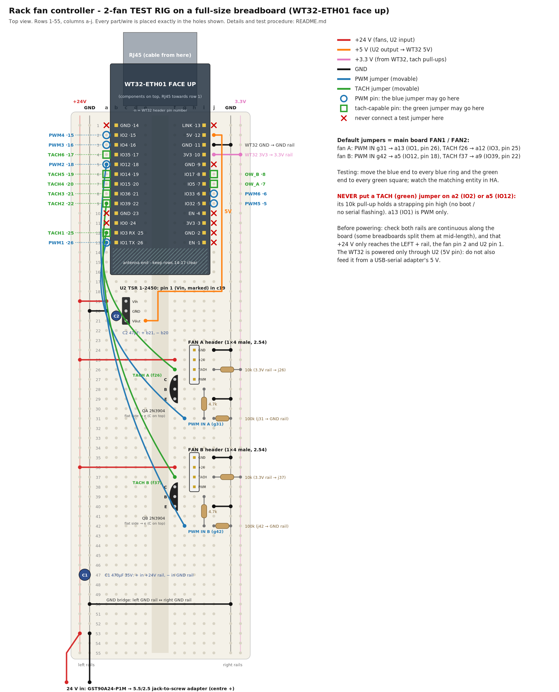

# Test rig: 2 fans on a breadboard

Temporary rig to check, before the PCB is built, that **every PWM pin and every tach pin** of the rack fan controller works. It uses the main board's circuit and pin map with only two fan channels. The fans' PWM and tach wires are jumpers that you move from pin to pin. This directory is meant to be removed once the test is done.

- Drawing: [`wiring.png`](wiring.png) (or [`wiring.svg`](wiring.svg)): every part and wire in its breadboard hole.
- Firmware: [`rack-fan-test.yaml`](rack-fan-test.yaml), for ESPHome 2026.10.1 on ESP-IDF. It compiles.
- Main board and pin decisions: [`../rack-fan-pcb/README.md`](../rack-fan-pcb/README.md).

## What it tests

| Signal | WT32 pin (GPIO) | Breadboard hole | Home Assistant entity |
|---|---|---|---|
| PWM1 | 26 (IO1) | a13 | `PWM1 pin26 IO1 duty` |
| PWM2 | 18 (IO12) | a5 | `PWM2 pin18 IO12 duty` |
| PWM3 | 16 (IO4) | a3 | `PWM3 pin16 IO4 duty` |
| PWM4 | 15 (IO2) | a2 | `PWM4 pin15 IO2 duty` |
| PWM5 | 5 (IO32) | j9 | `PWM5 pin5 IO32 duty` |
| PWM6 | 6 (IO33) | j8 | `PWM6 pin6 IO33 duty` |
| TACH1 | 25 (IO3) | a12 | `TACH1 pin25 IO3 rpm` |
| TACH2 | 22 (IO39) | a9 | `TACH2 pin22 IO39 rpm` |
| TACH3 | 21 (IO36) | a8 | `TACH3 pin21 IO36 rpm` |
| TACH4 | 20 (IO15) | a7 | `TACH4 pin20 IO15 rpm` |
| TACH5 | 19 (IO14) | a6 | `TACH5 pin19 IO14 rpm` |
| TACH6 | 17 (IO35) | a4 | `TACH6 pin17 IO35 rpm` |
| ONEWIRE_A (as tach) | 7 (IO5) | j7 | `ONEWIRE_A pin7 IO5 rpm` |
| ONEWIRE_B (as tach) | 8 (IO17) | j6 | `ONEWIRE_B pin8 IO17 rpm` |

On the 1-Wire pins:
- The main board's 1-Wire pins are tested here as tach inputs, to prove the GPIO, its connection through the socket and the module's LED path. They become 1-Wire again on the main board.
- The WT32's LED3 (IO5) and LED4 (IO17) blink with the fan's tach pulses. That's expected.

## Parts

| Qty | Part | Notes |
|---|---|---|
| 1 | Full-size breadboard (830 points, 63 rows, 2 rail pairs per side) | Check the rails are continuous along the board; some split them at mid-length (bridge them if so) |
| 1 | WT32-ETH01 with pin headers, **face up** | Plugged in columns **b** and **i** (rows 1–13), RJ45 towards row 1 |
| 1 | Traco TSR 1-2450 (U2) | 24 V → 5 V for the WT32 |
| 1 | 47 µF 10 V electrolytic (C2) | U2 output |
| 1 | 470 µF 35 V electrolytic (C1) | 24 V rail |
| 2 | 2N3904 (QA, QB) | PWM stage |
| 2 | 4.7 kΩ | Base resistors |
| 2 | 100 kΩ | GPIO pull-downs |
| 2 | 10 kΩ | Tach pull-ups to 3.3 V |
| 2 | 1 × 4 male pin header, 2.54 mm | Fan connectors (the fan's 4-pin plug goes on it) |
| 2 | 4-pin PWM fans | e.g. the Noctua NF-F12 industrialPPC-24V-3000 |
| 1 | Mean Well GST90A24-P1M + 5.5/2.5 mm barrel-jack-to-screw-terminal adapter | 24 V in, centre positive |
| — | Jumper wires | Colours as in the drawing: red 24 V, orange 5 V, pink 3.3 V, black GND, blue PWM, green tach |
| 1 | USB-serial adapter, **3.3 V logic** | First flash only |

These are the main board's parts, so the rig also checks the parts you'll use.

## Build, hole by hole

**Rails:**
- **Left:** + = **+24 V**, − = **GND**.
- **Right:** − = **GND**, + = **+3.3 V**.

The left + rail must never touch anything but the fans' pin 2, U2's pin 1 and C1.

**1. WT32-ETH01, face up:** left pin row in **b1–b13**, right pin row in **i1–i13**, RJ45 overhanging the top end (row 1), antenna towards row 14.
- The pins you'll use are reachable in column **a** (left row) and **j** (right row).
- Rows 14–17 are under the antenna end: leave them empty.

With the module face up and the RJ45 at the top, the pins are:

| Row | Column b (reach at a) | Column i (reach at j) |
|---|---|---|
| 1 | GND (14) | LINK (13) |
| 2 | IO2 (15) | 5V (12) |
| 3 | IO4 (16) | GND (11) |
| 4 | IO35 (17) | 3V3 (10) |
| 5 | IO12 (18) | GND (9) |
| 6 | IO14 (19) | IO17 (8) |
| 7 | IO15 (20) | IO5 (7) |
| 8 | IO36 (21) | IO33 (6) |
| 9 | IO39 (22) | IO32 (5) |
| 10 | GND (23) | EN (4) |
| 11 | IO0 (24) | 3V3 (3) |
| 12 | IO3 / RX (25) | GND (2) |
| 13 | IO1 / TX (26) | EN (1) |

Numbers in brackets are the WT32 header pins, the same as the PCB footprint.

**2. Supplies:**
- U2 TSR 1-2450 in **c19 (pin 1, Vin – marked) / c20 (GND) / c21 (Vout)**.
- C2: **+ in b21, − in b20**.
- Red **a19 → left + rail**. Black **a20 → left − rail**.
- Orange **e21 → j2** (WT32 5V).
- Pink **j4 → right + rail** (WT32 3V3 feeds the 3.3 V rail). Black **j3 → right − rail**.
- C1 across the left rails (+ on +24 V) near row 47.
- Black **GND bridge**: left − rail ↔ right − rail (row 50).
- 24 V in: adapter **+ → left + rail**, **− → left − rail** (row 53).

**3. Fan channel A** (rows 24–31) **and B** (rows 35–42, same pattern +11 rows):

| Row | Channel A / B | What goes there |
|---|---|---|
| 24 / 35 | fan pin 1 GND | header pin in **h**; black **j → right − rail** |
| 25 / 36 | fan pin 2 +24 V | header pin in **h**; red **f → left + rail** |
| 26 / 37 | fan pin 3 TACH | header pin in **h**; **10 kΩ right + rail (3.3 V) → j**; **green TACH jumper from f** |
| 27 / 38 | fan pin 4 PWM | header pin in **h**; 2N3904 **C** in **f** |
| 28 / 39 | base | 2N3904 **B** in **f**; 4.7 kΩ from **i28 / i39** … |
| 29 / 40 | emitter | 2N3904 **E** in **f**; black **j → right − rail** |
| 31 / 42 | PWM IN | … 4.7 kΩ to **i31 / i42**; **100 kΩ j → right − rail**; **blue PWM jumper from g** |

- **2N3904 orientation:** legs in f27/f28/f29 (f38/f39/f40) as C/B/E, so the **flat side faces column e** (towards the centre gap). Flat side towards you, the legs read E-B-C from left to right; with C at the top, the flat side must face e.
- **Fan header:** 1 × 4 male header in **h24–h27** (h35–h38), pin 1 (GND) at the top. Fit the fan's plug so its black wire (GND) is on row 24 (35). The plug's key doesn't matter on a bare header, so check the wire colours: GND black, +24 V yellow or red, tach green or white, PWM blue (Noctua: black, yellow, green, blue).

**4. Default test jumpers (the main board's FAN1 and FAN2):**
- Blue **g31 → a13** (PWM1, IO1). Green **f26 → a12** (TACH1, IO3).
- Blue **g42 → a5** (PWM2, IO12). Green **f37 → a9** (TACH2, IO39).

## Rules for moving the jumpers

- **Blue (PWM) ends** go only on the blue rings: a13, a5, a3, a2, j9, j8.
- **Green (TACH) ends** go only on the green squares: a12, a9, a8, a7, a6, a4, j7, j6.
- **Never put a green jumper on a2 (IO2) or a5 (IO12).** The channel's 10 kΩ pull-up would hold a strapping pin high. On IO12 the board won't boot; on IO2 serial flashing won't work. Also keep green off a13 (IO1, driven at boot).
- **Never connect a jumper** to the red ✗ holes: IO0 (a11), EN (j10, j13), the power pins.
- **Move jumpers with the 24 V off,** or at least never let a jumper end touch the 24 V rail.

## First flash (serial)

The WT32-ETH01 has no USB. For the first flash:
1. **Power off** (unplug the 24 V).
2. Unplug the two channel-A jumpers from **a12 and a13**; those are RX/TX.
3. Connect the USB-serial adapter (**3.3 V logic**, its 5 V **not** connected):
   - adapter **GND → a10**
   - adapter **TX → a12** (IO3 / RX)
   - adapter **RX → a13** (IO1 / TX)
4. Jumper **a11 (IO0) → left − rail (GND)**. This is the only time anything goes on a11.
5. Power on (24 V). The ESP32 starts in download mode.
6. Flash: `esphome run test-rig/rack-fan-test.yaml`, then choose the serial port.
7. Power off. Remove the IO0 jumper and the adapter, and put the channel-A jumpers back (g31 → a13, f26 → a12).
8. Power on. From now on, update over Ethernet (`esphome run` picks the network).

## Test procedure

Fans spin at 100% from power-on. The firmware starts every PWM at 100% in `on_boot`.

1. **Baseline:** with the default jumpers, both fans spin. `TACH1 pin25 IO3 rpm` and `TACH2 pin22 IO39 rpm` show the fans' speed, about 3000 RPM for the NF-F12 24V-3000 at 100%. The other tach entities read 0.
2. **Duty control:** set `PWM1 pin26 IO1 duty` to 50% and then 0%. Fan A slows, then drops to its minimum speed or stops (whether the NF-F12 24V-3000 stops at 0% is still unconfirmed; this test answers it), and its RPM follows. Back to 100%. Repeat with `PWM2 pin18 IO12 duty` for fan B.
3. **Every PWM pin:** move fan A's **blue** end to each blue ring in turn (a3, a2, j9, j8, then a5 with fan B moved away). Each time, use the matching `PWMn … duty` slider: only that slider must change fan A's speed.
4. **Every tach pin:** move fan A's **green** end to each green square in turn (a9, a8, a7, a6, a4, j7, j6). Each time, only the matching `… rpm` entity must show the fan's speed.
5. **Sweep:** press `Sweep all PWM`. All six PWM pins step 100 → 75 → 50 → 25 → 0 → 100 %, 10 s per step, and the RPM entities follow.
6. **Fail-safe:** restart the ESP32 (button) or pull its 5 V (orange jumper). Fans on PWM2–PWM6 stay at 100%; that's the transistor stage's fail-safe. A fan on PWM1 (IO1) stops for about a second at boot. That's expected, see the PCB README.

**What a pass looks like:**
- every slider controls the fan on its pin
- every RPM entity reads the fan on its pin
- RPM drops with duty
- nothing gets warm (U2 and the transistors stay cool)

Write down any pin that fails, together with the hole and the entity name.

## Notes

- **Tach readings** update every 2 s, with 2 pulses per revolution and the 13 µs glitch filter.
- **Pull-ups:** the 10 kΩ pull-up lives on the channel, so it travels with the green jumper. GPIO35/36/39 need no pull-up of their own.
- **Grounding:** this rig has no star ground; it's a test, not the final layout.
- **Cleanup:** remove this directory (`test-rig/`, including ESPHome's build folder `test-rig/.esphome/`) once the PCB is verified.
